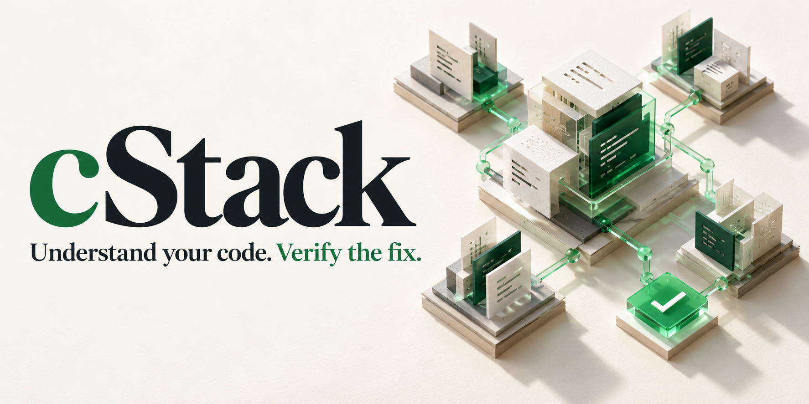
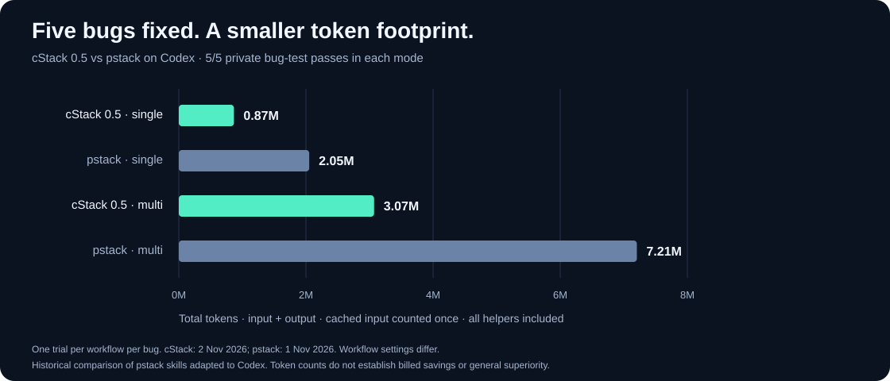
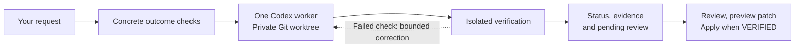

<p align="center">
  
</p>

<p align="center">
  <a href="package.json"></a>
  <a href="docs/VALIDATION.md"></a>
  <a href="#requirements"></a>
  <a href="LICENSE"></a>
</p>

<p align="center">
  <strong>Proof that "done" means done, for Claude Code, Codex and any agent workflow.</strong><br>
  Frozen checks. Run by cStack, not the agent. Offline, sandboxed, bound to the exact files.
</p>

<p align="center">
  <a href="#quick-start">Quick start</a> ·
  <a href="#see-it-in-30-seconds">Demo</a> ·
  <a href="#five-skills-one-plugin">Skills</a> ·
  <a href="#how-it-works">How it works</a> ·
  <a href="#measuring-false-completions">Benchmark</a> ·
  <a href="#documentation">Documentation</a>
</p>

---

Coding agents say "done" when the build is green, when they think they are finished, or when they have quietly edited the tests. cStack moves that decision out of the agent. It runs acceptance checks itself, first on your current code (they must fail, proving they detect the problem) and then on the change, in an offline OS sandbox with your project's own installed dependencies. A change that does nothing, only touches tests, rewrites its own checks or fails a check is not done, whatever the agent says.

## What you can do with it

- **Gate any agent's work:** `cstack verify` checks a change already in your working copy, made by Claude Code, Codex, Cursor, pstack or a person. No model is called. Re-check right before commit or merge with `verify --check`. [Verify a change →](docs/VERIFY.md)
- **Fix a bug in one command:** `cstack fix "GOAL"` drafts small probe checks, proves they fail on today's code, shows you the expected behavior to approve, then fixes against exactly those checks with a Claude Code or Codex worker.
- **Try several fixes when one fails:** optional alternates run in parallel, even across vendors, and the smallest change that passes every check wins. Evidence decides, not another model.
- **Understand a project first:** dependency maps, stack inventories and change impact without a model.

## Quick start

**Claude Code** (2.1.275 or newer):

```text
/plugin install cstack --marketplace PrzemyslaV88/cstack
```

Or in two steps: `/plugin marketplace add PrzemyslaV88/cstack`, then `/plugin install cstack@cstack`. Start a new session and use `/cstack:verify`, `/cstack:cstack`, `/cstack:graph-map`, `/cstack:stack-analysis` or `/cstack:impact-analysis`. While the plugin is enabled, `cstack` is also on the PATH of Claude's Bash tool.

**Codex:**

```sh
git clone https://github.com/PrzemyslaV88/cstack.git && cd cstack
npm run plugin:install
```

Open a new Codex chat in your project and use `$cstack:verify`, `$cstack:cstack` and the analysis skills.

**Command line only:** clone the repository and run `node src/cli.mjs` (Node 22.13+). `npm run plugin:install:claude` installs a local build into Claude Code instead of the GitHub marketplace.

```text
$cstack:verify Check my change against .cstack/checks.json before I call it done.
$cstack:cstack Fix the discount bug: orders over 100 should get 10% off.
```

Repairs use a signed-in Claude Code (`--worker claude`) or Codex (`--worker codex`) CLI. Analysis and `verify` need neither. [Setup →](docs/SETUP.md)

## See it in 30 seconds

`npm run demo` needs no model or login. A cart total ignores item quantity; an "agent" claims a wrong fix, then rewrites the checks, then makes a real fix:

```text
1. The agent "fixes" it and says: "Done, all tests pass."
   cstack verify
  → FAILED: Required checks fail on this change: QTY (FAIL)
    QTY: Expected 24; observed 12

2. The agent edits the checks so they pass and says "Done" again.
   cstack verify
  → FAILED: Required checks fail on this change: QTY (FAIL)
    (the edited checks were ignored: verify read them from the committed base)
    QTY: Expected 24; observed 12

3. A real fix.
   cstack verify
  → DONE: All required checks pass on this change with current evidence, and no review is pending.
```

## Five skills, one plugin

| Skill | What you get | Useful when… |
|---|---|---|
| **Graph map** | Python, JavaScript and TypeScript file dependencies; incoming/outgoing imports; file/line evidence; Markdown, JSON and Mermaid exports. | You need to understand a codebase or identify files worth reviewing before a change. |
| **Stack analysis** | Scoped application/test/example/benchmark inventories; language, framework and tool declarations; entrypoints and error-frame locations with file evidence. | You are onboarding to a project or investigating a Python/Node error trace. |
| **Impact analysis** | Direct dependencies, downstream consumers, candidate tests, import cycles, and labelled historical edges for deleted files; Markdown, JSON and Mermaid exports. | You want to see which parts of a project may be affected by a file or Git change. |
| **Checked repair** | `cstack fix`: drafted probe checks you approve, then one Claude Code or Codex worker in a private worktree; optional parallel alternates chosen by evidence; progress, usage and review reports; patch preview and recoverable delivery. | You want a focused fix with an inspectable completion record. |
| **Verify** | A model-free `done` / `failed` / `needs_you` verdict for an existing change: checks fail on the base and pass on the change, frozen checks, sandboxed, evidence bound to the exact tree; `--check` before commit or merge. | Another agent or workflow (pstack, Claude Code, Cursor) made the change and you need proof before calling it done. |

**Error locations, too.** Supply a Python or Node.js error trace to stack analysis to match its frames back to project files. Reported locations guide investigation; they do not prove the root cause.

Repairs can start from a clean project or explicitly capture your existing working-copy edits. Delivery preserves staging and rejects source drift; see [working-copy support](docs/REVIEW_AND_DELIVERY.md#start-with-existing-edits-in-05).

The analysis helpers run locally without starting another model worker or requiring login. They leave project files untouched and write reports to a new directory outside the project. Import mapping is heuristic and file-level; technology versions are declarations rather than verified installed versions. [Capabilities and boundaries →](docs/PROJECT_ANALYSIS.md)

<details>
<summary><strong>Try the analysis tools directly on this checkout</strong></summary>

```sh
node src/cli.mjs map --repo . --out ../cstack-map
node src/cli.mjs analyze-stack --repo . --out ../cstack-stack
node src/cli.mjs impact --repo . --file src/core.mjs --out ../cstack-impact
```

The graph report includes `graph.md`, `graph.json` and `graph.mmd`. Stack analysis exports `stack.md` and `stack.json`; impact analysis exports `impact.md`, `impact.json` and `impact.mmd`. Existing output directories are preserved. Use `--focus relative/file.py` to prioritize a graph file, or `--format json` to print structured results instead of exporting.

The scanner reports limits and skipped files. It excludes credential-named inputs and common generated/dependency folders. A partial scan stays explicitly partial.

</details>

## Measuring false completions

The benchmark that matters asks: when an agent says "done", is it done, and does cStack catch it when it is not? [`bench/fc.mjs`](bench/fc/README.md) records three independent facts per trial:
- **claim:** did the agent say done?
- **gate:** what does `cstack verify` say?
- **truth:** do held-out hidden checks that no agent saw pass?

It reports false completions, how many the gate caught, and good fixes the gate wrongly blocked, with 95% intervals. Arms can be plain Claude Code, plain Codex, cStack with either worker, or runs imported from elsewhere, such as pstack in Cursor.

Six small seed tasks are included and validated, and scripted agents show the expected behaviour:
- a lazy "done" is caught;
- rewriting the checks is caught;
- overfitting the public checks passes the gate and is caught only by hidden cases.

**No results from real models are published yet.** Those runs need model accounts and are the next step.

## Earlier benchmark (cStack 0.5)

**Historical: cStack 0.5 versus pstack on five selected public SWE-bench bugs.** These runs predate the Claude worker, `verify` and the Docker removal, used a Codex adaptation of pstack with every role on one model, and all workflows passed, so they say nothing about false completions. Real GPT-6.1 Sol invocations, Codex CLI 0.163.0, Docker verification and a separate private bug grader. All workflows below passed all five bug tasks.



| Mode | Workflow | Private bug-test passes | Total tokens | Combined task time |
|---|---|---:|---:|---:|
| Single-agent | **cStack 0.5** | **5/5** | **867,374** | **346.4 s** |
| Single-agent | pstack | 5/5 | 2,051,785 | 485.3 s |
| Multi-agent | **cStack 0.5** | **5/5** | **3,071,947** | **484.5 s** |
| Multi-agent | pstack | 5/5 | 7,205,517 | 630.1 s |
| Single-agent | plain Codex (1 Nov) | 5/5 | 914,058 | 288.1 s |
| Multi-agent | plain Codex (1 Nov) | 5/5 | 2,996,134 | 402.9 s |

These runs used cStack 0.5 with its former Docker verifier. Plain-Codex rows come from the [five-arm batch](docs/BATCH_COMPARISON_RESULTS.md).

| cStack advantage over the corresponding pstack mode | Single-agent | Multi-agent |
|---|---:|---:|
| Fewer total tokens | **57.7%** | **57.4%** |
| Less task time | **28.6%** | **23.1%** |
| Fewer tokens excluding cached input | **47.9%** | **46.4%** |

**What is counted.** Tokens are input plus output, with cached input counted once. Multi-agent totals include the parent and both actual helpers on each task. Task time includes agent work, controller checks and candidate delivery; it excludes environment setup and final private grading. Token counts are not subscription credits or billed cost.

**What was tested.** The same five bug tasks and public/private test inputs were used. cStack was measured on 2 November 2026; the pstack measurements were recorded on 1 November. The pstack workflows use pinned skills adapted to Codex, with workflow-specific reasoning and orchestration settings. This is a small historical comparison with one trial per workflow per case; model, cache and service variation limit conclusions. Separate grading is a separate test process, not external certification.

**Checks and review remain separate.** All ten cStack candidates passed the private bug tests on their first controller attempt. All ten still require human review of protected test changes. An automated test pass does not award final `VERIFIED` status or approve delivery.

**Why one coding worker by default?** On these five tasks, cStack's multi-agent mode used **3.54× as many tokens** and took **40% longer** than its single-agent mode, with the same five passing results. The installed repair skill uses one coding worker; multi-agent cStack remains an experimental benchmark adapter.

This benchmark measures the bug-fix workflow. Project setup, analysis skills, HTML review, delivery usability and retry/resume improvements have separate functional validation; the table does not measure their end-to-end user benefit.

[Comparison data and source identities](docs/benchmarks/2026-11-02-cstack-vs-pstack.json) · [Benchmark setup](bench/README.md) · [Completion and review rules](docs/CONTRACT.md)

## How it works



- **Prepare and reproduce.** Save a private project profile that names your installed dependency folders (for example `node_modules` or `.venv`), and freeze concrete checks in a repair plan. Baseline checks reproduce the problem before a coding worker starts; already-satisfied outcomes spend no worker tokens.
- **Send focused context.** Select bounded source excerpts using error frames, symbols, failing tests and import relationships. Context manifests record what was selected and omitted; resumed threads can omit unchanged excerpts.
- **Use existing test suites.** Run supported pytest, Vitest and Node test adapters in isolation, with expected test identities and explicit failures for missing, skipped or malformed results. Independent probes check the requested behavior.
- **One environment.** The worker and the verifier use the same installed dependencies, linked read-only into the private worktree and every sealed candidate. Links are controller owned, excluded from patches and fingerprinted: a dependency change makes earlier evidence stale.
- **Keep the work separate.** The worker changes a private Git worktree. Explicit working-copy mode includes existing tracked and nonignored untracked edits while recording staging separately. Verification runs on a sealed candidate, with evidence tied to its contents and the selected runner.
- **Check outside the candidate.** Verification checks declared outcomes; early exits, missing outputs and invented “PASS” text cannot stand in for expected probe results. The verifier runs in an OS sandbox (Linux namespaces or macOS Seatbelt): no network, read-only candidate, home directory and credentials hidden, private scratch only. It proves those properties with a self-test before every use and refuses to run otherwise.
- **Keep review explicit.** Changes to existing tests/configuration require human review of that specific candidate. Additive Python test edits are exempt when existing tests are unchanged and every required check also passes with the original test files; added tests are also run against the baseline to record fail-to-pass evidence. A manual approval cannot turn a failed automated check into a pass.
- **Follow progress.** Use `status --watch`, `runs`, `report` and criterion-specific evidence to inspect stage changes, token completeness and pending review.
- **Resume with the record intact.** Attempts, active time and observed token usage are recorded. Resuming keeps consumed budgets. The token ceiling controls admission of further turns; a completed turn can overshoot it.
- **Review and deliver.** Generate private HTML, Markdown, JSON and diff reports. Preview a binary-capable patch, check destination drift, and apply a VERIFIED candidate while preserving staging. Durable backups and journals support interrupted-delivery recovery; conflicting user edits are preserved. Export remains available for a separate candidate directory.

| Status | What it tells you |
|---|---|
| `VERIFIED` | The configured required checks and review gates have current evidence for this candidate. |
| `NEEDS_MANUAL_VERIFICATION` | A human review or acceptance step remains. Automated checks may already have passed. |
| `BLOCKED` / `STALLED` / `BUDGET_EXHAUSTED` | Work stopped with a recorded reason. Completion has not been awarded. |

cStack is an early-stage local tool. Its checks establish the configured outcomes; human engineering review remains part of delivery. [Contracts](docs/CONTRACT.md) · [Security boundaries](docs/SECURITY.md)

## Requirements

| Workflow | Requirements |
|---|---|
| Local graph, stack and impact helpers | Node.js **22.13+** and the project files. Git is optional for directory analysis. |
| Codex plugin installation | Node.js **22.13+** and Codex CLI with `codex plugin` support; tested with **0.163.0**. |
| Checked repairs | Git, a signed-in Claude Code CLI (2.1.259+, subscription login; bash sandbox needs `bubblewrap` and `socat` on Linux) or Codex CLI (ChatGPT login), with API-key login only when explicitly selected, and the project's own dependencies installed in git-ignored folders. Linux needs unprivileged user namespaces; macOS uses the built-in `sandbox-exec`. Use WSL2 for Windows. |
| Optional benchmark tooling | Python **3.12**, Docker (SWE-bench tasks ship as images; cStack itself does not use Docker) and the [pinned benchmark environment](bench/README.md). |

cStack does not install project dependencies, build images or fall back to API-key billing; API-key worker auth is used only when `CSTACK_CODEX_AUTH=api-key` is set. The coding worker uses Codex's own sandbox; cStack's isolated verifier is a separate boundary. The registered local marketplace must remain available for future refreshes; the installed runtime runs from Codex's cache. [Setup details →](docs/CODEX_PLUGIN.md)

## Validation and development

The 0.5 functional release gate passed **168 core/package tests, 90 benchmark regression tests and 4 offline grader tests**, covering **144 required acceptance IDs** ([release receipt](docs/validation/upgrade-0.5.0.json)). 0.6 has no release receipt yet.

```sh
npm run check
npm test   # host sandbox; no Docker
# Vitest adapter tests need an installed Vitest 4, e.g. `npm ci` in test/fixtures/environments/vitest:
CSTACK_TEST_VITEST_MODULES=/path/to/node_modules npm test
# With the Python 3.12 benchmark environment active:
python -m unittest discover -s bench -t . -p 'test_*.py' -v
```

Tests that need a missing toolchain (Vitest, the native Codex CLI) skip with the reason instead of failing. Harbor-specific integration tests require the pinned benchmark environment; without it, those tests are skipped. The recorded release gate used that environment. Validation runs locally. GitHub CI is disabled; pushes and pull requests do not start GitHub-hosted test jobs.

Tests cover false completion, isolation, changed evidence, crash/retry/resume behavior, fixture guards, protected-test review, plugin relocation, Python/TypeScript mapping and report exports. Raw model traces, authentication, task caches and local operator notes stay outside Git. The benchmark summary publishes the measured rows without those private artifacts.

[Validation records](docs/VALIDATION.md) · [Plugin setup](docs/CODEX_PLUGIN.md) · [Benchmark setup](bench/README.md)

## Documentation

| Start here | What it covers |
|---|---|
| [Codex plugin guide](docs/CODEX_PLUGIN.md) | Installation, skill discovery, requirements and installed-package validation. |
| [Graph mapping and stack analysis](docs/PROJECT_ANALYSIS.md) | Supported formats, error frames, exports, evidence and scan limits. |
| [Verify a change](docs/VERIFY.md) | The `verify` gate, checks files, outcomes, pstack integration, hooks and CI. |
| [False-completion benchmark](bench/fc/README.md) | Claim versus gate versus hidden truth, arms, tasks and importing pstack runs. |
| [Release checklist](docs/launch/CHECKLIST.md) | What must be checked on real machines and accounts before announcing. |
| [Completion contracts](docs/CONTRACT.md) | Observable checks, review steps and the frozen repair objective. |
| [cStack versus pstack](docs/benchmarks/2026-11-02-cstack-vs-pstack.json) | Current comparison figures, mode-specific advantages, methodology and source identities. |
| [Project setup](docs/SETUP.md) | Private profiles, installed dependency folders, baseline reproduction and supported test adapters. |
| [Review and delivery](docs/REVIEW_AND_DELIVERY.md) | HTML review, working-copy repairs, patch preview, staging preservation and interrupted-delivery recovery. |
| [Change impact](docs/IMPACT.md) | Downstream consumers, candidate tests, deleted-file edges and import cycles. |
| [Physical improvement tests](docs/PHYSICAL_TEST_RESULTS.md) | Real Docker/Codex exercises for fixture handling and controlled recovery. |
| [Security boundaries](docs/SECURITY.md) | What is isolated and what still depends on Codex/the host. |
| [Design history](docs/ARCHITECTURE.md) | Original architecture proposal and roadmap; not a list of shipped guarantees. |
| [Upgrade implementation plan](docs/UPGRADE_IMPLEMENTATION_PLAN.md) | Detailed 0.4/0.5 design, implementation backlog, acceptance tests and release gates; see validation records for measured scope. |

Contributions are welcome: [local development and bug reports](CONTRIBUTING.md).
For vulnerabilities, use [private security reporting](SECURITY.md).

Licensed under [MIT](LICENSE).
