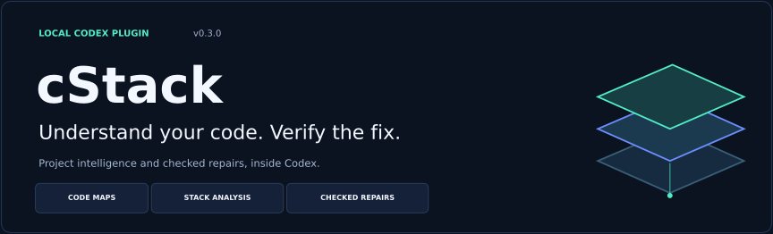
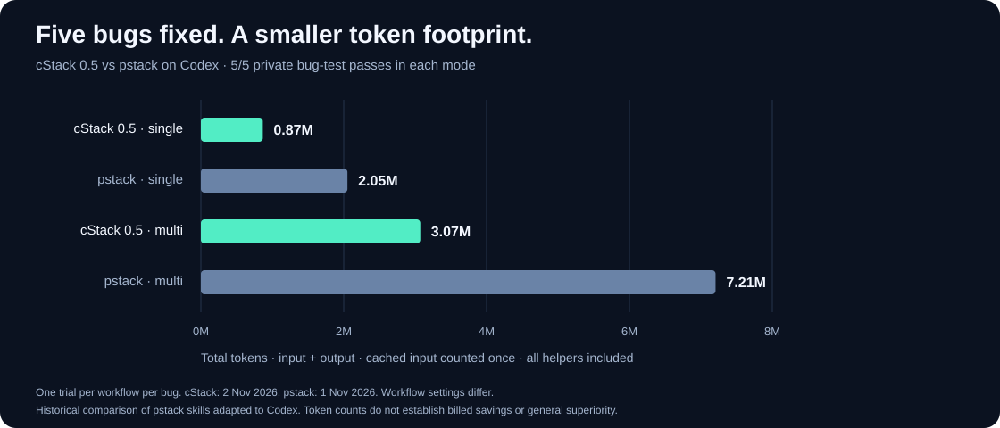
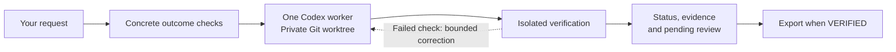

<p align="center">
  
</p>

<p align="center">
  <a href="package.json"></a>
  <a href="docs/CODEX_PLUGIN.md"></a>
  <a href="#requirements"></a>
  <a href="LICENSE"></a>
</p>

<p align="center">
  <strong>Three Codex skills for understanding projects and delivering independently checked repairs.</strong><br>
  Local tools. Focused context. Evidence you can review.
</p>

<p align="center">
  <a href="#quick-start">Quick start</a> ·
  <a href="#three-skills-one-plugin">Skills</a> ·
  <a href="#benchmarks">Benchmarks</a> ·
  <a href="#how-it-works">How it works</a> ·
  <a href="#documentation">Documentation</a>
</p>

---

cStack helps you understand an unfamiliar project, make a focused fix, and inspect the result. Its repair workflow gives one Codex worker a separate Git worktree, then checks the candidate against concrete expected behavior. Completion is backed by recorded checks and explicit review gates.

## A smaller recorded token footprint

<table>
  <tr>
    <td align="center" width="33%"><h3>5 / 5</h3>Independent bug-test cases passed<br>in the single-agent follow-up</td>
    <td align="center" width="33%"><h3>62% fewer tokens</h3>Than the saved pstack<br>single-agent workflow</td>
    <td align="center" width="33%"><h3>89% fewer tokens</h3>Than the saved pstack<br>multi-agent workflow</td>
  </tr>
</table>

**Observed on five selected bugs, with one trial per workflow per case.** These compare the later single-agent cStack follow-up with saved pstack skills adapted to Codex. Controller revisions and execution periods differed. They are descriptive token counts, not a general quality ranking or a billing-savings estimate. The benchmarks predate the 0.3 graph/stack-analysis additions. [See the full comparison and limits →](#benchmarks)

## Quick start

Install from the repository using a Codex CLI with native plugin support:

```sh
git clone https://github.com/PrzemyslaV88/cstack.git
cd cstack
npm run plugin:install
```

The installer builds the bundled runtime, registers a local marketplace, and enables `cstack@cstack-local`. There is no hosted cStack service or runtime npm dependency installation.

Open a **new Codex chat** in your project and choose a skill. Restart Codex if the new skills are not visible.

```text
$cstack:graph-map Map this project and explain its main dependencies.
```

```text
$cstack:stack-analysis Explain the languages, frameworks and build/test tools in this project.
```

```text
$cstack:cstack Fix this bug and independently check that the fix works.
```

Analysis works on current files, including dirty projects. Repairs require a clean Git starting revision, a supported authenticated Codex CLI, and an available isolated verifier. cStack preserves existing work rather than stashing, committing or discarding it to satisfy a clean-source requirement. [Installation and setup →](docs/CODEX_PLUGIN.md)

## Three skills, one plugin

| Skill | What you get | Useful when… |
|---|---|---|
| **Graph map** | Python, JavaScript and TypeScript file dependencies; incoming/outgoing imports; file/line evidence; Markdown, JSON and Mermaid exports. | You need to understand a codebase or identify files worth reviewing before a change. |
| **Stack analysis** | Languages, declared runtime/dependency versions, framework and tool signals, candidate entrypoints, and configuration evidence. | You are onboarding to a project or checking how its parts fit together. |
| **Checked repair** | One coding worker, a private worktree, concrete outcome checks, bounded attempts, saved evidence and snapshot-specific review gates. | You want a focused fix with an inspectable completion record. |

**Error locations, too.** Supply a Python or Node.js error trace to stack analysis to match its frames back to project files. Reported locations guide investigation; they do not prove the root cause.

The analysis helpers run locally without starting another model worker or requiring Docker/login. They leave project files untouched and write reports to a new directory outside the project. Import mapping is heuristic and file-level; technology versions are declarations rather than verified installed versions. [Capabilities and boundaries →](docs/PROJECT_ANALYSIS.md)

<details>
<summary><strong>Try the analysis tools directly on this checkout</strong></summary>

```sh
node src/cli.mjs map --repo . --out ../cstack-map
node src/cli.mjs analyze-stack --repo . --out ../cstack-stack
```

The graph report includes `graph.md`, `graph.json` and `graph.mmd`. Stack analysis exports `stack.md` and `stack.json`. Existing output directories are preserved. Use `--focus relative/file.py` to prioritize a graph file, or `--format json` to print structured results instead of exporting.

The scanner reports limits and skipped files. It excludes credential-named inputs and common generated/dependency folders. A partial scan stays explicitly partial.

</details>

## Benchmarks

**Real Codex invocations, Docker checks and a separate private bug grader.** The local comparison used GPT-6.1 Sol, Codex CLI 0.163.0, the same five selected public SWE-bench bugs, and saved native usage records for parent and helper agents.



**Chart scope:** saved baselines plus the later cStack follow-up, one trial per workflow per case. These runs used different controller revisions and predate 0.3's analysis tools. All parent/helper tokens are included; cached input is counted once. Separate grading means a separate test process, not an external certification study.

| Workflow | Run group | Bug-test passes | Total tokens | Combined task time |
|---|---|---:|---:|---:|
| **cStack · single-agent** | **Follow-up** | **5/5** | **773,930** | **329.0 s** |
| Plain Codex · single-agent | Earlier | 5/5 | 914,058 | 288.1 s |
| pstack · single-agent | Earlier | 5/5 | 2,051,785 | 485.3 s |
| Plain Codex · multi-agent | Earlier | 5/5 | 2,996,134 | 402.9 s |
| cStack · multi-agent | Follow-up | 5/5 | 3,291,046 | 575.3 s |
| pstack · multi-agent | Earlier | 5/5 | 7,205,517 | 630.1 s |

Task time includes agent work, workflow checks and candidate delivery; it excludes environment provisioning and final private grading. The pstack rows exercise pinned skills adapted to Codex, rather than the native Cursor/Claude plugin runtime. Token counts do not measure subscription credits or billed cost.

**Why one coding worker by default?** In the paired cStack follow-up, helpers used **4.25× as many tokens** and took **75% longer**, with the same five passing bug-test results. Single-agent cStack used fewer tokens and took less task time on every paired case. Multi-agent cStack remains a benchmark experiment; the installed repair skill uses one coding worker.

**The complete record includes the rough edges.** The original cStack baseline passed 4/5 cases and stopped before model invocation on a Sphinx test-certificate fixture. That failed attempt remains in the published record; its four-run token aggregate is excluded from the chart above. The later controller admitted reviewed, exact-content test fixtures and completed all five cases. Of the ten follow-up cStack candidates, **one reached `VERIFIED`; nine still required human review of existing test changes**, despite passing the separate bug tests.

Plain Codex was faster than the cStack single-agent follow-up in these records. Plain Codex multi-agent also used fewer tokens and took less time than cStack multi-agent. Five selected bugs with one trial each do not establish a general winner or a reliable speedup.

[All 35 scheduled attempts and analysis](docs/CSTACK_MULTIAGENT_RESULTS.md) · [Published machine-readable summary](docs/benchmarks/2026-11-01-results.json) · [Original protocol](docs/BATCH_COMPARISON_PROTOCOL.md) · [Follow-up protocol](docs/CSTACK_MULTIAGENT_PROTOCOL.md)

## How it works



- **Define the outcome.** Freeze observable checks before work starts. The controller compares actual results with those expectations.
- **Keep the work separate.** The worker changes a private Git worktree. Verification runs on a sealed candidate, with evidence tied to its contents and the selected runner.
- **Check outside the candidate.** Verification checks declared outcomes; early exits, missing outputs and invented “PASS” text cannot stand in for expected probe results. The default Docker verifier has no outbound network or host-credential mount.
- **Keep review explicit.** Changes to existing tests/configuration require human review of that specific candidate. A manual approval cannot turn a failed automated check into a pass.
- **Resume with the record intact.** Attempts, active time and observed token usage are recorded. Resuming keeps consumed budgets. The token ceiling controls admission of further turns; a completed turn can overshoot it.
- **Hand off a checked candidate.** Export writes a new directory with the candidate and report. It does not automatically apply, commit, push, merge or deploy the change.

| Status | What it tells you |
|---|---|
| `VERIFIED` | The configured required checks and review gates have current evidence for this candidate. |
| `NEEDS_MANUAL_VERIFICATION` | A human review or acceptance step remains. Automated checks may already have passed. |
| `BLOCKED` / `STALLED` / `BUDGET_EXHAUSTED` | Work stopped with a recorded reason. Completion has not been awarded. |

cStack is an early-stage local tool. Its checks establish the configured outcomes; human engineering review remains part of delivery. [Contracts](docs/CONTRACT.md) · [Security boundaries](docs/SECURITY.md)

## Requirements

| Workflow | Requirements |
|---|---|
| Local graph/stack helpers | Node.js **22.13+** and the project files. Git is optional for directory analysis. |
| Codex plugin installation | Node.js **22.13+** and Codex CLI with `codex plugin` support; tested with **0.163.0**. |
| Checked repairs | Git, supported Codex CLI with existing ChatGPT sign-in, and Docker with a prepared runtime image appropriate for the project. |
| Alternative verifier | Explicit Linux namespace runner on compatible hosts. Use WSL2 for Windows. |
| Optional benchmark tooling | Python **3.12**, Docker and the [pinned benchmark environment](bench/README.md). |

cStack does not silently install project dependencies or fall back to API-key billing. The coding worker uses Codex's own sandbox; cStack's isolated verifier is a separate boundary. The registered local marketplace must remain available for future refreshes; the installed runtime runs from Codex's cache. [Setup details →](docs/CODEX_PLUGIN.md)

## Validation and development

Latest recorded local validation: **90 core/package tests + 77 benchmark regression tests passed**, including real Docker isolation checks and installed-plugin exercises. The native Codex skill listing confirmed all three enabled skills. Analysis was exercised on a Python/TypeScript sample and cStack's own repository, including 52 supported source modules and 110 resolved import relationships at scan time.

```sh
npm run check
CSTACK_TEST_RUNNER=docker npm test
# With the Python 3.12 benchmark environment active:
python -m unittest discover -s bench -t . -p 'test_*.py' -v
```

Docker tests require an available engine and the selected image. Harbor-specific integration tests require the pinned benchmark environment; without it, those tests are skipped. The full local counts above used that environment. CI runs the Docker suite on Node 22/24; consult the [actual workflow runs](https://github.com/PrzemyslaV88/cstack/actions/workflows/ci.yml) for remote status.

Tests cover false completion, isolation, changed evidence, crash/retry/resume behavior, fixture guards, protected-test review, plugin relocation, Python/TypeScript mapping and report exports. Raw model traces, authentication, task caches and local operator notes stay outside Git. The benchmark summary publishes the measured rows without those private artifacts.

[Validation records](docs/VALIDATION.md) · [Installed-plugin checks](docs/CODEX_PLUGIN.md#version-030-analysis-validation) · [Benchmark setup](bench/README.md)

## Documentation

| Start here | What it covers |
|---|---|
| [Codex plugin guide](docs/CODEX_PLUGIN.md) | Installation, skill discovery, requirements and installed-package validation. |
| [Graph mapping and stack analysis](docs/PROJECT_ANALYSIS.md) | Supported formats, error frames, exports, evidence and scan limits. |
| [Completion contracts](docs/CONTRACT.md) | Observable checks, review steps and the frozen repair objective. |
| [Full comparison results](docs/CSTACK_MULTIAGENT_RESULTS.md) | Paired cStack modes, saved baselines and the complete 35-attempt record. |
| [Physical improvement tests](docs/PHYSICAL_TEST_RESULTS.md) | Real Docker/Codex exercises for fixture handling and controlled recovery. |
| [Security boundaries](docs/SECURITY.md) | What is isolated and what still depends on Codex/the host. |
| [Design history](docs/ARCHITECTURE.md) | Original architecture proposal and roadmap; not a list of shipped guarantees. |

Licensed under [MIT](LICENSE).
