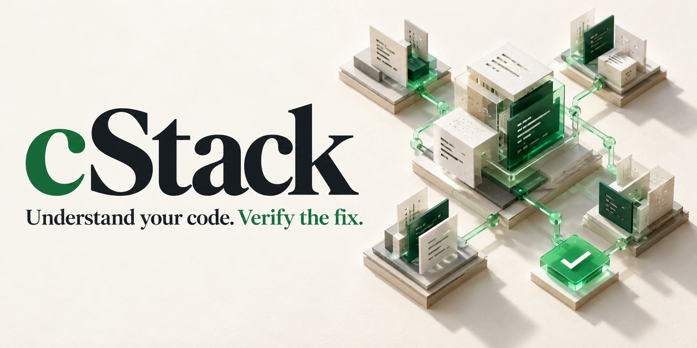
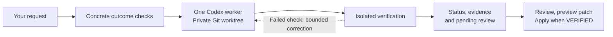

<p align="center">
  
</p>

<p align="center">
  <a href="package.json"></a>
  <a href="docs/VALIDATION.md"></a>
  <a href="#requirements"></a>
  <a href="LICENSE"></a>
</p>

<p align="center">
  <strong>Four Codex skills for understanding projects and delivering independently checked repairs.</strong><br>
  Local tools. Focused context. Evidence you can review.
</p>

<p align="center">
  <a href="#quick-start">Quick start</a> ·
  <a href="#four-skills-one-plugin">Skills</a> ·
  <a href="#benchmarks">Benchmarks</a> ·
  <a href="#how-it-works">How it works</a> ·
  <a href="#documentation">Documentation</a>
</p>

---

cStack helps you understand an unfamiliar project, make a focused fix, and inspect the result. Its repair workflow gives one Codex worker a separate Git worktree, then checks the candidate against concrete expected behavior. Completion is backed by recorded checks and explicit review gates.

## From project discovery to a checked change

- **Prepare once:** private project profiles, explicit dependency-image plans, and a baseline that reproduces the requested problem.
- **Find relevant code:** error locations, exact symbols, failing tests, and import relationships select bounded repair context.
- **Inspect the result:** scoped stack reports, change-impact maps, and private HTML review reports explain evidence and pending review.
- **Deliver carefully:** preview a binary-capable patch, apply without changing staging, and recover interrupted delivery without overwriting a concurrent edit.

[Set up a project](docs/SETUP.md) · [Review and delivery](docs/REVIEW_AND_DELIVERY.md) · [Change impact](docs/IMPACT.md)

## Less overhead. The same five bugs fixed.

<table>
  <tr>
    <td align="center" width="33%"><h3>5 / 5</h3>Private bug-test passes<br>in each cStack mode</td>
    <td align="center" width="33%"><h3>57.7% fewer tokens</h3>Single-agent cStack<br>compared with pstack single-agent</td>
    <td align="center" width="33%"><h3>57.4% fewer tokens</h3>Multi-agent cStack<br>compared with pstack multi-agent</td>
  </tr>
</table>

**cStack 0.5 completed the five selected bug fixes with less task time and fewer tokens than the recorded pstack workflows.** The comparison uses pstack skills adapted to Codex, with real helpers in multi-agent mode. One trial per workflow per bug; execution dates and workflow settings differ. These results describe this benchmark, not a general quality ranking or a billing estimate. [Results and methodology →](#benchmarks)

## Quick start

Install from the repository using a Codex CLI with native plugin support:

```sh
git clone https://github.com/PrzemyslaV88/cstack.git
cd cstack
npm run plugin:install
```

The installer builds the bundled runtime, registers a local marketplace, and enables `cstack@cstack-local`. There is no hosted cStack service or runtime npm dependency installation.

Open a **new Codex chat** in your project and choose a skill. Restart Codex if the new skills are not visible.

```text
$cstack:graph-map Map this project and explain its main dependencies.
```

```text
$cstack:stack-analysis Explain the languages, frameworks and build/test tools in this project.
$cstack:impact-analysis Show likely consumers and tests affected by src/engine.py.
```

```text
$cstack:cstack Fix this bug and independently check that the fix works.
```

Analysis works on current files, including dirty projects. Repairs use a clean Git baseline by default; explicit working-copy mode captures existing edits and preserves staging. Coding requires a supported authenticated Codex CLI and an available isolated verifier. [Installation and setup →](docs/CODEX_PLUGIN.md)

## Four skills, one plugin

| Skill | What you get | Useful when… |
|---|---|---|
| **Graph map** | Python, JavaScript and TypeScript file dependencies; incoming/outgoing imports; file/line evidence; Markdown, JSON and Mermaid exports. | You need to understand a codebase or identify files worth reviewing before a change. |
| **Stack analysis** | Scoped application/test/example/benchmark inventories; language, framework and tool declarations; entrypoints and error-frame locations with file evidence. | You are onboarding to a project or investigating a Python/Node error trace. |
| **Impact analysis** | Direct dependencies, downstream consumers, candidate tests, import cycles, and labelled historical edges for deleted files; Markdown, JSON and Mermaid exports. | You want to see which parts of a project may be affected by a file or Git change. |
| **Checked repair** | Project setup and frozen plans; one coding worker; independent checks; progress, usage and private review reports; patch preview and recoverable delivery. | You want a focused fix with an inspectable completion record. |

**Error locations, too.** Supply a Python or Node.js error trace to stack analysis to match its frames back to project files. Reported locations guide investigation; they do not prove the root cause.

Repairs can start from a clean project or explicitly capture your existing working-copy edits. Delivery preserves staging and rejects source drift; see [working-copy support](docs/REVIEW_AND_DELIVERY.md#start-with-existing-edits-in-05).

The analysis helpers run locally without starting another model worker or requiring Docker/login. They leave project files untouched and write reports to a new directory outside the project. Import mapping is heuristic and file-level; technology versions are declarations rather than verified installed versions. [Capabilities and boundaries →](docs/PROJECT_ANALYSIS.md)

<details>
<summary><strong>Try the analysis tools directly on this checkout</strong></summary>

```sh
node src/cli.mjs map --repo . --out ../cstack-map
node src/cli.mjs analyze-stack --repo . --out ../cstack-stack
node src/cli.mjs impact --repo . --file src/core.mjs --out ../cstack-impact
```

The graph report includes `graph.md`, `graph.json` and `graph.mmd`. Stack analysis exports `stack.md` and `stack.json`; impact analysis exports `impact.md`, `impact.json` and `impact.mmd`. Existing output directories are preserved. Use `--focus relative/file.py` to prioritize a graph file, or `--format json` to print structured results instead of exporting.

The scanner reports limits and skipped files. It excludes credential-named inputs and common generated/dependency folders. A partial scan stays explicitly partial.

</details>

## Benchmarks

**cStack 0.5 versus pstack on five selected public SWE-bench bugs.** Real GPT-6.1 Sol invocations, Codex CLI 0.163.0, Docker verification and a separate private bug grader. All workflows below passed all five bug tasks.


| Mode | Workflow | Private bug-test passes | Total tokens | Combined task time |
|---|---|---:|---:|---:|
| Single-agent | **cStack 0.5** | **5/5** | **867,374** | **346.4 s** |
| Single-agent | pstack | 5/5 | 2,051,785 | 485.3 s |
| Multi-agent | **cStack 0.5** | **5/5** | **3,071,947** | **484.5 s** |
| Multi-agent | pstack | 5/5 | 7,205,517 | 630.1 s |

| cStack advantage over the corresponding pstack mode | Single-agent | Multi-agent |
|---|---:|---:|
| Fewer total tokens | **57.7%** | **57.4%** |
| Less task time | **28.6%** | **23.1%** |
| Fewer tokens excluding cached input | **47.9%** | **46.4%** |

**What is counted.** Tokens are input plus output, with cached input counted once. Multi-agent totals include the parent and both actual helpers on each task. Task time includes agent work, controller checks and candidate delivery; it excludes environment setup and final private grading. Token counts are not subscription credits or billed cost.

**What was tested.** The same five bug tasks and public/private test inputs were used. cStack was measured on 2 November 2026; the pstack measurements were recorded on 1 November. The pstack workflows use pinned skills adapted to Codex, with workflow-specific reasoning and orchestration settings. This is a small historical comparison with one trial per workflow per case; model, cache and service variation limit conclusions. Separate grading is a separate test process, not external certification.

**Checks and review remain separate.** All ten cStack candidates passed the private bug tests on their first controller attempt. All ten still require human review of protected test changes. An automated test pass does not award final `VERIFIED` status or approve delivery.

**Why one coding worker by default?** On these five tasks, cStack's multi-agent mode used **3.54× as many tokens** and took **40% longer** than its single-agent mode, with the same five passing results. The installed repair skill uses one coding worker; multi-agent cStack remains an experimental benchmark adapter.

This benchmark measures the bug-fix workflow. Project setup, analysis skills, HTML review, delivery usability and retry/resume improvements have separate functional validation; the table does not measure their end-to-end user benefit.

[Comparison data and source identities](docs/benchmarks/2026-11-02-cstack-vs-pstack.json) · [Benchmark setup](bench/README.md) · [Completion and review rules](docs/CONTRACT.md)

## How it works



- **Prepare and reproduce.** Save a private project profile, select a prepared verifier image, and freeze concrete checks in a repair plan. Baseline checks reproduce the problem before a coding worker starts; already-satisfied outcomes spend no worker tokens.
- **Send focused context.** Select bounded source excerpts using error frames, symbols, failing tests and import relationships. Context manifests record what was selected and omitted; resumed threads can omit unchanged excerpts.
- **Use existing test suites.** Run supported pytest, Vitest and Node test adapters in isolation, with expected test identities and explicit failures for missing, skipped or malformed results. Independent probes check the requested behavior.
- **Keep the work separate.** The worker changes a private Git worktree. Explicit working-copy mode includes existing tracked and nonignored untracked edits while recording staging separately. Verification runs on a sealed candidate, with evidence tied to its contents and the selected runner.
- **Check outside the candidate.** Verification checks declared outcomes; early exits, missing outputs and invented “PASS” text cannot stand in for expected probe results. The default Docker verifier has no outbound network or host-credential mount.
- **Keep review explicit.** Changes to existing tests/configuration require human review of that specific candidate. A manual approval cannot turn a failed automated check into a pass.
- **Follow progress.** Use `status --watch`, `runs`, `report` and criterion-specific evidence to inspect stage changes, token completeness and pending review.
- **Resume with the record intact.** Attempts, active time and observed token usage are recorded. Resuming keeps consumed budgets. The token ceiling controls admission of further turns; a completed turn can overshoot it.
- **Review and deliver.** Generate private HTML, Markdown, JSON and diff reports. Preview a binary-capable patch, check destination drift, and apply a VERIFIED candidate while preserving staging. Durable backups and journals support interrupted-delivery recovery; conflicting user edits are preserved. Export remains available for a separate candidate directory.

| Status | What it tells you |
|---|---|
| `VERIFIED` | The configured required checks and review gates have current evidence for this candidate. |
| `NEEDS_MANUAL_VERIFICATION` | A human review or acceptance step remains. Automated checks may already have passed. |
| `BLOCKED` / `STALLED` / `BUDGET_EXHAUSTED` | Work stopped with a recorded reason. Completion has not been awarded. |

cStack is an early-stage local tool. Its checks establish the configured outcomes; human engineering review remains part of delivery. [Contracts](docs/CONTRACT.md) · [Security boundaries](docs/SECURITY.md)

## Requirements

| Workflow | Requirements |
|---|---|
| Local graph, stack and impact helpers | Node.js **22.13+** and the project files. Git is optional for directory analysis. |
| Codex plugin installation | Node.js **22.13+** and Codex CLI with `codex plugin` support; tested with **0.163.0**. |
| Checked repairs | Git, supported Codex CLI with existing ChatGPT sign-in, and Docker with a prepared runtime image appropriate for the project. |
| Alternative verifier | Explicit Linux namespace runner on compatible hosts. Use WSL2 for Windows. |
| Optional benchmark tooling | Python **3.12**, Docker and the [pinned benchmark environment](bench/README.md). |

cStack does not silently install project dependencies or fall back to API-key billing. The coding worker uses Codex's own sandbox; cStack's isolated verifier is a separate boundary. The registered local marketplace must remain available for future refreshes; the installed runtime runs from Codex's cache. [Setup details →](docs/CODEX_PLUGIN.md)

## Validation and development

The 0.5 functional release gate passed **168 core/package tests, 90 benchmark regression tests and 4 offline grader tests**, covering **144 required acceptance IDs**. Validation includes real Docker test adapters, working-copy preservation, review and recoverable delivery, relocated plugin execution and native skill discovery in an isolated profile. [Machine-readable release receipt](docs/validation/upgrade-0.5.0.json).

```sh
npm run check
CSTACK_TEST_RUNNER=docker npm test
# With the Python 3.12 benchmark environment active:
python -m unittest discover -s bench -t . -p 'test_*.py' -v
```

Docker tests require an available engine and the selected image. Harbor-specific integration tests require the pinned benchmark environment; without it, those tests are skipped. The recorded release gate used that environment. Validation runs locally. GitHub CI is disabled; pushes and pull requests do not start GitHub-hosted test jobs.

Tests cover false completion, isolation, changed evidence, crash/retry/resume behavior, fixture guards, protected-test review, plugin relocation, Python/TypeScript mapping and report exports. Raw model traces, authentication, task caches and local operator notes stay outside Git. The benchmark summary publishes the measured rows without those private artifacts.

[Validation records](docs/VALIDATION.md) · [Plugin setup](docs/CODEX_PLUGIN.md) · [Benchmark setup](bench/README.md)

## Documentation

| Start here | What it covers |
|---|---|
| [Codex plugin guide](docs/CODEX_PLUGIN.md) | Installation, skill discovery, requirements and installed-package validation. |
| [Graph mapping and stack analysis](docs/PROJECT_ANALYSIS.md) | Supported formats, error frames, exports, evidence and scan limits. |
| [Completion contracts](docs/CONTRACT.md) | Observable checks, review steps and the frozen repair objective. |
| [cStack versus pstack](docs/benchmarks/2026-11-02-cstack-vs-pstack.json) | Current comparison figures, mode-specific advantages, methodology and source identities. |
| [Project setup](docs/SETUP.md) | Private profiles, explicit dependency-image preparation, baseline reproduction and supported test adapters. |
| [Review and delivery](docs/REVIEW_AND_DELIVERY.md) | HTML review, working-copy repairs, patch preview, staging preservation and interrupted-delivery recovery. |
| [Change impact](docs/IMPACT.md) | Downstream consumers, candidate tests, deleted-file edges and import cycles. |
| [Physical improvement tests](docs/PHYSICAL_TEST_RESULTS.md) | Real Docker/Codex exercises for fixture handling and controlled recovery. |
| [Security boundaries](docs/SECURITY.md) | What is isolated and what still depends on Codex/the host. |
| [Design history](docs/ARCHITECTURE.md) | Original architecture proposal and roadmap; not a list of shipped guarantees. |
| [Upgrade implementation plan](docs/UPGRADE_IMPLEMENTATION_PLAN.md) | Detailed 0.4/0.5 design, implementation backlog, acceptance tests and release gates; see validation records for measured scope. |

Contributions are welcome: [local development and bug reports](CONTRIBUTING.md).
For vulnerabilities, use [private security reporting](SECURITY.md).

Licensed under [MIT](LICENSE).
